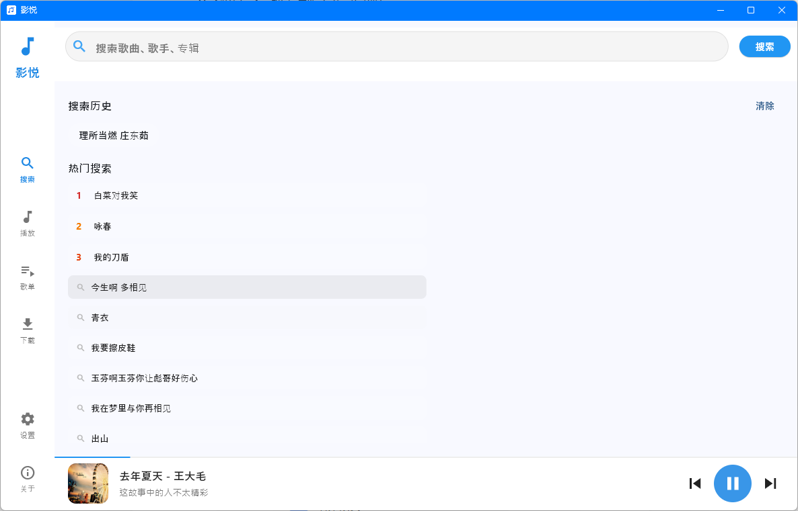
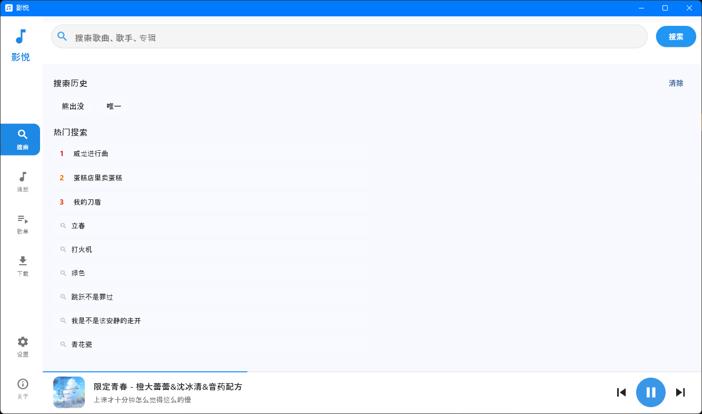
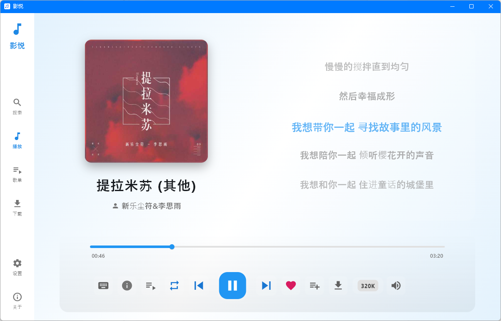
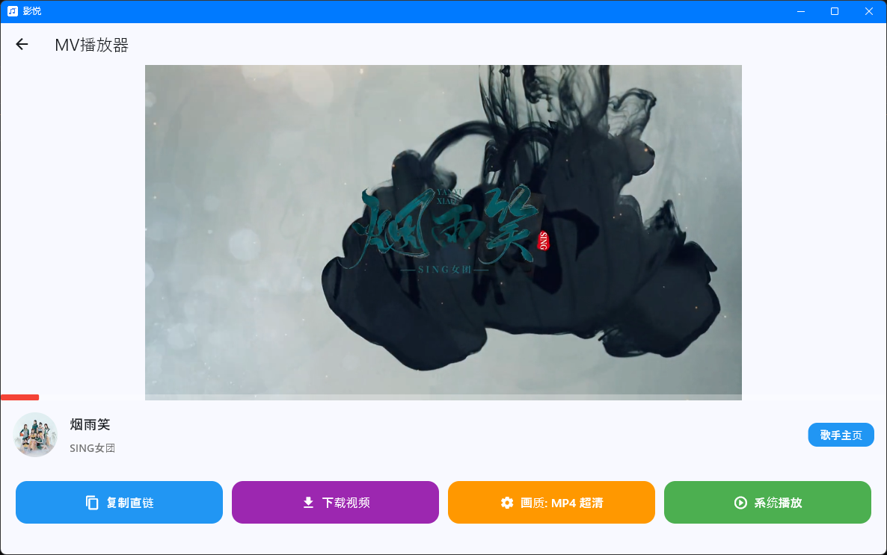
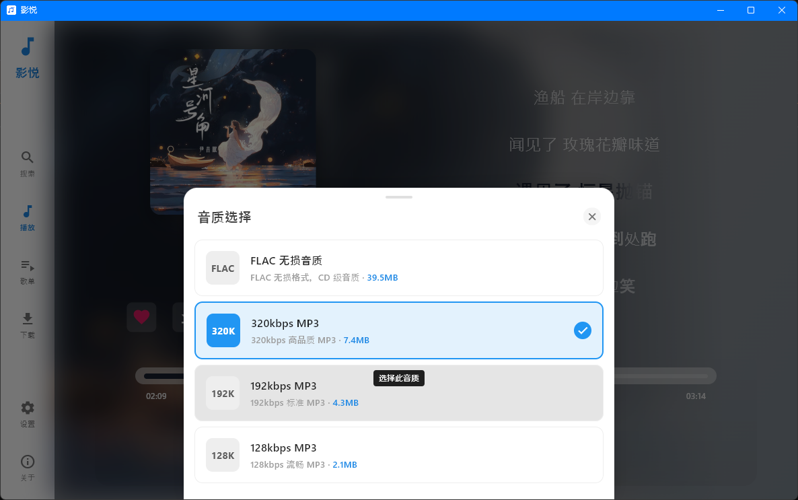
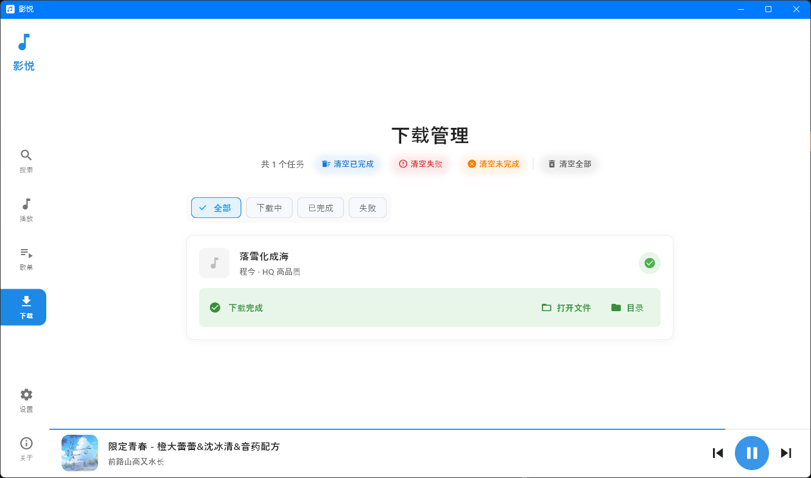
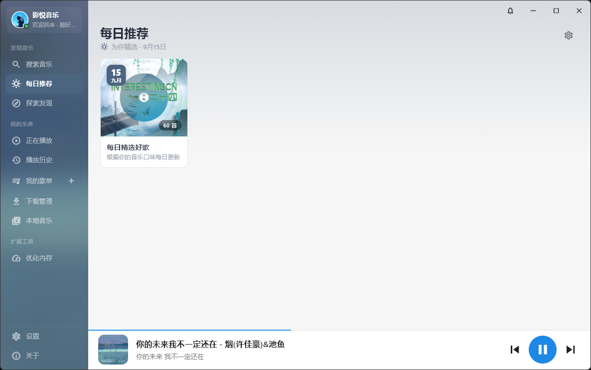
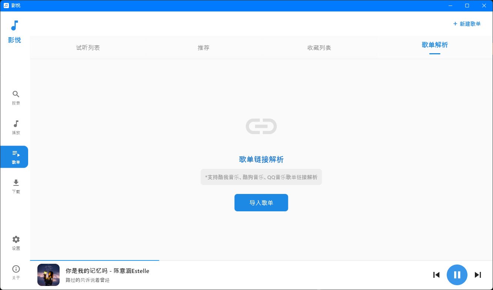
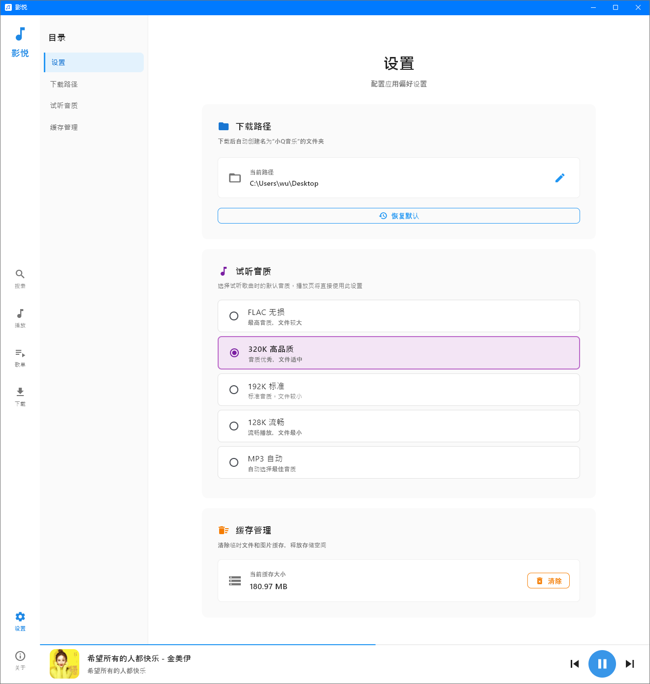

<!-- Logo 或标题可以放在这里 -->

# 影悦（yymusic）
一款免费的音乐播放软件，支持在线搜索、播放、下载和管理音乐。
 

<!-- 技术栈与下载部分 -->

 

 

 

[🐛 反馈问题 / 提交建议](https://gitee.com/suyuebai/yy-music/issues)

## 友情链接

# 迟言API
一个快速，稳定，易用的API

## 项目简介

影悦是一款基于 Flutter 开发的免费音乐播放软件，提供了丰富的音乐资源和便捷的音乐管理功能。

- **免费使用**：完全免费，无广告
- **丰富资源**：支持搜索和播放海量音乐
- **高品质音质**：支持多种音质选择，包括无损音质
- **本地管理**：支持本地音乐管理和播放
- **美观界面**：简约美观的用户界面

## 功能特点

- ✅ 音乐搜索：支持关键词搜索音乐
- ✅ 音乐播放：支持在线播放和本地播放
- ✅ 音质选择：支持多种音质选择，包括无损音质
- ✅ 歌词显示：支持歌词同步显示
- ✅ 音乐下载：支持下载音乐到本地
- ✅ 歌单管理：支持创建和管理歌单（支持其他音乐平台的歌单导入）
- ✅ 播放历史：记录播放历史
- ✅ 热门搜索：显示热门搜索关键词

## 技术栈

- **前端框架**：Flutter 3.0+
- **后端 API**：调用第三方音乐 API
- **音频播放**：just_audio
- **网络请求**：http
- **本地存储**：shared_preferences, path_provider
- **加密**：crypto
- **中文编码**：gbk_codec
- **图片缓存**：cached_network_image
- **文件操作**：file_picker, open_file

## 安装说明

### 系统要求

- Windows 7 及以上
- Android版本还躺在我的计划里，不过核心功能已开发放到了小Q盒子[（点击去下载）](https://gitee.com/suyuebai/xqhz_apk)里了，搜索试听下载没问题。
- IOS 版暂时不计划

### 安装步骤

1. 从 [Releases](https://gitee.com/suyuebai/yy-music/releases) 页面下载最新版本的安装包
2. 双击安装包进行安装
3. 安装完成后，在开始菜单或应用程序文件夹中找到并启动影悦

## 使用说明

### 搜索音乐

1. 在搜索框中输入关键词
2. 点击搜索按钮、按回车键或点击弹出的搜索建议
3. 在搜索结果中点击歌曲进行播放

### 播放音乐

1. 在搜索结果或歌单中点击歌曲
2. 歌曲会在底部播放器中开始播放
3. 可以使用底部播放器控制播放、暂停、上一曲、下一曲、音量、试听音质、添加到歌单
4、播放页UI随着图片的颜色自动变化

### MV
1、多种清晰度选择
2、复制直链

### 下载音乐

1. 在搜索结果中右键点击歌曲
2. 选择"下载"选项
3. 选择音质后点击"确定"
4. 下载完成后，可以在"下载管理"页面查看

### 歌单管理

1. 点击左侧导航栏中的"歌单"
2. 可以创建新歌单或管理现有歌单（支持重复名称的歌单名，创建后支持修改）
3. 可以将歌曲添加到歌单中
4、可导入KW以及其他平台的歌单

### 设置

1. 支持修改下载路径
2. 支持试听音质修改
3. 可随时清理缓存（试听歌曲会占用存储空间，清理发现还剩下几十MB？这是正常的，因为有文件正在被占用，不必理会）

## 联系方式

- 开发者：苏月白
- suyuebai-wys@outlook.com

---

**温馨提示**：本软件仅供个人学习和研究使用，请勿用于商业用途。